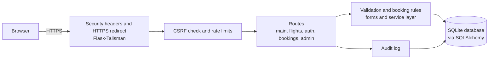
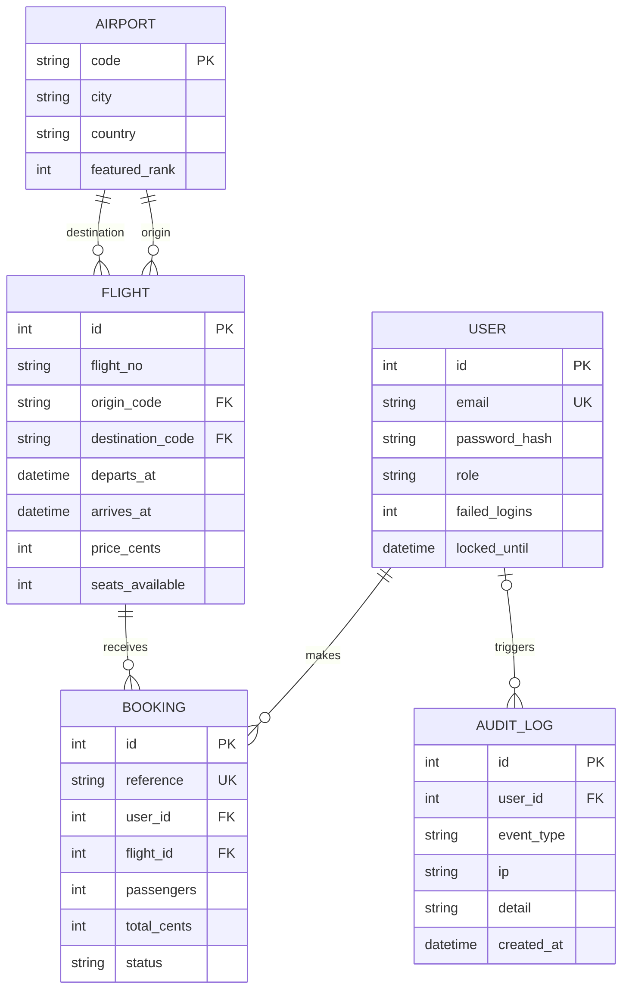
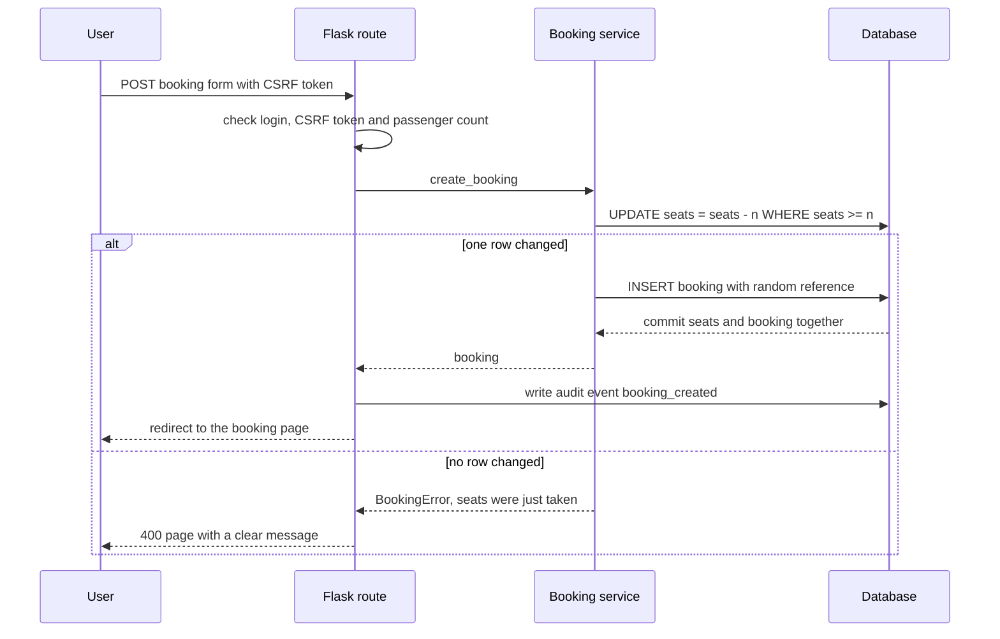
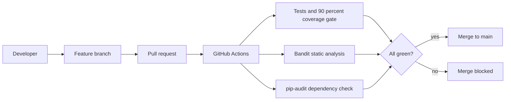

# SecurePass architecture

SecurePass is a server-rendered Flask application. The browser receives finished HTML pages,
so sessions, validation and access control all stay on the server.

## System overview

| Part | Technology | Responsibility |
|---|---|---|
| Frontend | HTML, CSS, a little JavaScript, Jinja templates | Pages, forms, small helpers such as upper-casing airport codes |
| Web layer | Flask with blueprints | One blueprint per area: `main`, `flights`, `auth`, `bookings`, `admin` |
| Security layer | Flask-Talisman, Flask-WTF, Flask-Limiter, Flask-Login | Headers, CSRF, rate limits, sessions |
| Rules | `app/bookings/service.py`, `app/flights/validation.py`, forms | Business rules kept out of the route functions |
| Data | SQLite through Flask-SQLAlchemy | Five tables, with database constraints as a second line of defence |

## Data model

Database rules that hold even if application code has a bug: seats can never be negative,
a flight cannot start and end at the same airport, a booking has 1 to 9 passengers and a valid
status, a role is only `user` or `admin`, and a flight number can depart only once at a given time.

## How a booking is made safely

The last seat must never be sold twice, even when two people press the button at the same
moment. The seat count is changed with one conditional `UPDATE`, so the database itself does
"check and subtract" as a single step.

The price is never read from the browser: the server works out the total from the flight.

## Layers of defence on a request

1. **Transport.** In production, HTTP is redirected to HTTPS and HSTS tells browsers to
   stay on HTTPS. The session cookie is `Secure`, `HttpOnly`, `SameSite=Lax` and named
   `__Host-session`.
2. **Browser rules.** The Content-Security-Policy allows only this site; fonts, styles and scripts are all served from its own static folder. Framing,
   plugins and injected `<base>` tags are blocked. Private pages are sent with `Cache-Control: no-store`.
3. **Request checks.** Every POST needs a CSRF token. Login and registration are rate limited.
   Request bodies are limited to 100 KB.
4. **Identity and access.** Flask-Login sessions, a lockout after 5 failed logins, a guard on the whole
   admin blueprint, and booking lookups by owner and reference.
5. **Input.** Every field is validated on the server. Database access uses SQLAlchemy only, and
   templates auto-escape output.
6. **Evidence.** Security events are written to the audit log and shown on the admin dashboard.

## Delivery pipeline

Dependabot opens a weekly pull request for newer Python packages and GitHub Actions, and each
of those goes through the same gates.

## Running it in production

| Setting | Value |
|---|---|
| `FLASK_ENV` | `production` (turns on HTTPS redirect, HSTS, Secure cookies) |
| `SECRET_KEY` | A random value of at least 32 characters. The app refuses to start otherwise. |
| `DATABASE_URL` | Optional. Defaults to `instance/securepass.db`. |
| `PROXY_HOPS` | Number of reverse proxies in front of the app (for example `1`). Leave at `0` when there is none. |

Run it with a production server, not `flask run`: Waitress on Windows, Gunicorn on Linux, with a
reverse proxy that handles the TLS certificate. Create the first admin with
`flask --app wsgi create-admin`. Back up the `instance/` folder.

## Known limits

SQLite suits a demo, not heavy traffic (PostgreSQL would be the next step). Rate-limit counters live
in memory. There is no email verification, password reset or two-factor authentication yet, and
payments are simulated.